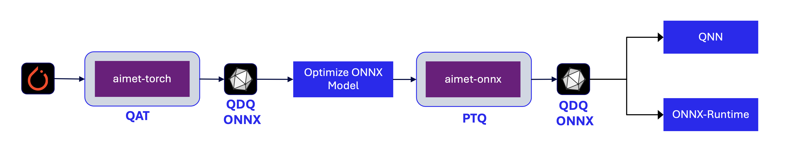

.. _techniques-qat:

###########################
Quantization-aware training
###########################

.. note::
    Not supported in ``aimet-onnx``.

Quantization-aware training (QAT) finds better optimized solutions than post-training quantization (PTQ)
by fine-tuning the model parameters in the presence of quantization noise. This higher accuracy comes with
the usual costs of neural network training, including longer training times and the need for labeled data
and hyperparameter search.

Variants of QAT
===============

There are two main variants of QAT: **without range learning** and **with range learning**.

Without range learning
      In this approach, activation quantization parameters (such as scale and offset) are *not learnable* and remain fixed throughout training.

With range learning
      In this approach, activation quantization parameters are treated as learnable parameters. While this dynamic adjustment can *further reduce quantization noise*, this advantage comes at the cost of *significantly increased memory usage*.

In both variants, quantization parameters for model parameters (such as weight) are treated as learnable.

Typical recommendations
=======================

- **Initialization**: Apply PTQ techniques (such as :ref:`Sequential MSE <featureguide-seq-mse>`) before starting QAT.

  *This is especially more important if there is a large drop in INT8 performance compared to the FP baseline.
  QAT is a fine-tuning technique that relies on a reasonably well-performing quantized model as a starting point.
  Without a solid baseline, its benefit tends to be limited.*

- **Learning rate**: Use a small learning rate.

  *Start with a small learning rate, and reduce it by a factor of 10 every few epochs.
  The main goal of QAT is fine-tuning. Since quantization parameters are often sensitive to even minor updates, a small learning rate is typically recommended for stable convergence.*

- **Target layers for QAT**: Whenever possible, apply QAT selectively to layers that are sensitive to quantization.

  *Applying QAT to all layers is not only memory-intensive but can also negatively impact convergence.
  Quantization parameters that were already near-optimal may drift away from the optimum during QAT.
  For instance, INT16 quantization typically does not require QAT due to its high precision.
  In constrast, lower-bit quantization formats such as INT8 or INT4 are more likely to benefit from QAT, as they are more susceptible to quantization noise*

Workflow
========

.. _techniques-qat-setup:

Step 1: Setup
-------------

Set up the model, data loader, and callback functions.

.. literalinclude:: ../snippets/torch/apply_qat.py
    :language: python
    :start-after: # setup
    :end-before: # step_1

.. _techniques-qat-encodings:

Step 2: Compute initial quantization parameters
-----------------------------------------------

Compute initial quantization parameters and evaluate accuracy.

.. literalinclude:: ../snippets/torch/apply_qat.py
    :language: python
    :start-after: # step_1
    :end-before: # step_2

.. rst-class:: script-output

    .. code-block:: none

        Quantized accuracy (W8A8): 0.68016

.. _techniques-qat-calibrate:

Step 3: Run quantization-aware training
---------------------------------------

Train the model to fine-tune quantization parameters.

.. literalinclude:: ../snippets/torch/apply_qat.py
    :language: python
    :start-after: # step_2
    :end-before: # step_3

.. rst-class:: script-output

    .. code-block:: none

        Model accuracy after QAT: 0.70838

API
===

.. autoclass:: aimet_torch.QuantizationSimModel
    :members: compute_encodings, export
    :member-order: bysource
    :no-index:
