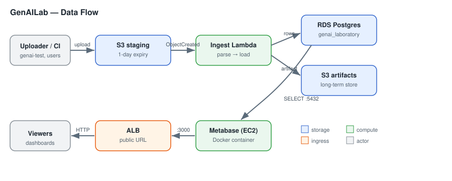

# GenAILab Dashboard & Analytics

This directory holds everything behind the **GenAILab Metabase dashboards**: the
data pipeline that populates the analytics database, the SQL that powers the
dashboard questions, and the ingest Lambda source.

> This README is architecture-level only — no account IDs, IP addresses, ARNs,
> or secret names. Concrete resource identifiers, the security-group matrix, and
> IAM/secret detail are maintained separately in the internal infrastructure
> documentation.

## Architecture

Test/quantization results are exported, uploaded to a **staging S3 bucket**, and
an **ingest Lambda** parses each upload — writing structured rows into a
**Postgres (RDS)** database, copying each model export zip to the **artifacts
S3 bucket** and a zip of that export's results (config, profiling data,
analysis report), without the model data, to the **results S3 bucket**. A **Metabase**
instance (Docker on EC2) reads the database and serves dashboards through a
public **Application Load Balancer**.



## What's in this directory

| Path | Contents |
|------|----------|
| [`queries/`](./queries/) | SQL for the Metabase dashboard questions, grouped by result type |
| `queries/aggregated_results/` | Cross-run scatter/table + precision tags |
| `queries/llm_results/` | LLM torch / onnx / cross-framework accuracy tables |
| `queries/vlm_results/` | VLM torch / onnx / cross-framework accuracy tables |
| [`lambda/ingest/`](./lambda/ingest/) | Ingest Lambda source + build script |
| [`diagrams/`](./diagrams/) | SVG source for the diagram embedded above |
| [`ops/`](./ops/) | Operations runbook (Metabase upgrade, backup, recovery) |

## Data pipeline summary

1. **Upload** → staging S3 bucket (objects auto-expire after 1 day).
2. **Trigger** → `s3:ObjectCreated:*` invokes the ingest Lambda.
3. **Ingest** → Lambda parses the export, inserts rows into Postgres, and copies
   each model zip to the artifacts bucket and its results zip to the results
   bucket (both under `exports/`).
4. **Serve** → Metabase queries Postgres; the ALB exposes the dashboards.

## Common tasks

- **Add / edit a dashboard query:** put the SQL under the right `queries/`
  subfolder and wire it into the corresponding Metabase question.
- **Build / deploy the ingest Lambda:** build with `lambda/ingest/build.sh`, then
  upload the zip via the Lambda web console — see
  [`lambda/ingest/README.md`](./lambda/ingest/README.md).
- **Operate Metabase (upgrade, backup, recover):** see
  [`ops/operations-runbook.md`](./ops/operations-runbook.md).
- **Refresh the infrastructure inventory:** see the internal infrastructure
  documentation for the read-only AWS discovery scripts.

## Related

- Ingest Lambda source: `lambda/ingest/`
- Checkpoint download helper: `aimet/scripts/all/download_genai_checkpoint.sh`
- CI that uploads results: the `genai-test` GitHub Actions path

# Operations Runbook

Procedures for running and recovering the GenAILab / Metabase stack. These are
captured from real operations — follow them exactly; the gotchas are load-bearing.

## Metabase upgrade (Docker + H2 app DB)

**Context:** Metabase runs as Docker container `metabase` on the EC2 host, image
`metabase/metabase:latest`, volume `metabase-data`. App state is **embedded H2**
at `/metabase-data/metabase.db/metabase.db.mv.db` — *not* the analytics RDS.

1. **Back up the H2 file** (this is the only rollback; the RDS snapshot does NOT
   cover Metabase's own state):
   ```bash
   docker stop metabase
   cp -a /var/lib/docker/volumes/metabase-data/_data/metabase.db \
         /root/metabase-h2-backup-<date>
   # confirm metabase.db.mv.db is present at full size (~tens of MB)
   ```
2. **Pull + recreate**, pinning the DB path (critical):
   ```bash
   docker pull metabase/metabase:latest
   docker rm metabase
   docker run -d --name metabase --restart always -p 3000:3000 \
     -v metabase-data:/metabase-data \
     -e MB_DB_TYPE=h2 \
     -e MB_DB_FILE=/metabase-data/metabase.db/metabase.db \
     metabase/metabase:latest
   ```
   > ⚠️ **Gotcha:** the `latest` image no longer bakes in `MB_DB_FILE`. Without
   > the explicit `-e MB_DB_FILE=...`, Metabase creates a **fresh empty H2** and
   > you get the setup wizard ("blank instance") while your real data sits
   > untouched at the old path. Always pass it.
3. **Watch migration:** `docker logs -f metabase` → expect Liquibase
   `Run: N, Previously run: M` (M>0 means it adopted your DB) and
   `Metabase Initialization COMPLETE`. Do not interrupt.
4. **Verify:** login screen (not setup wizard); dashboards + RDS connection present.

### "Blank instance" recovery

If you see the setup wizard after an upgrade: **don't click through.** The old
DB is almost certainly intact at a path the new container isn't reading.
```bash
docker inspect metabase --format 'Mounts: {{json .Mounts}}'   # confirm volume attached
ls -la /var/lib/docker/volumes/metabase-data/_data/metabase.db/  # find real .mv.db (~tens of MB)
```
Recreate with the correct `-e MB_DB_FILE=` pointing at that file (see step 2).

### Rollback
```bash
docker stop metabase && docker rm metabase
rm -rf /var/lib/docker/volumes/metabase-data/_data/metabase.db
cp -a /root/metabase-h2-backup-<date>/metabase.db \
      /var/lib/docker/volumes/metabase-data/_data/metabase.db
docker run -d --name metabase --restart always -p 3000:3000 \
  -v metabase-data:/metabase-data \
  -e MB_DB_FILE=/metabase-data/metabase.db/metabase.db \
  <OLD_IMAGE_ID>
```
Don't `docker image prune` until the upgrade is confirmed healthy (keeps the old
image as a rollback target).

> **Follow-up:** H2 is not recommended for production. Migrating Metabase's app
> DB to Postgres (`MB_DB_TYPE=postgres`) is a worthwhile hardening task.
